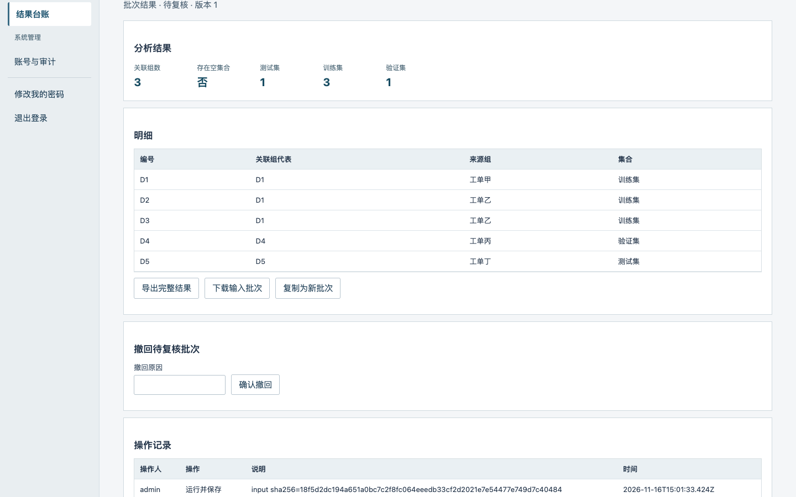
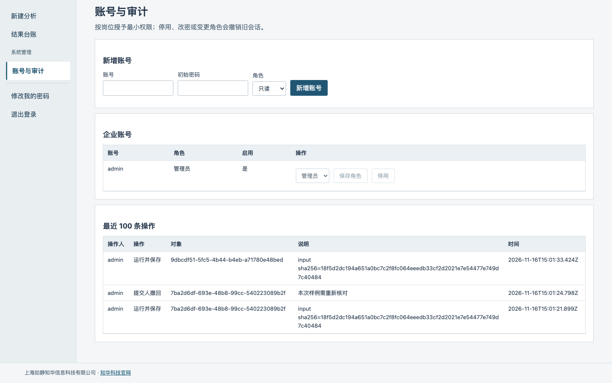

# 知华训练数据防泄漏划分

[English](README.en.md) · 训练数据准备 · Java 21 / Spring Boot / MySQL 8.4 / 响应式 H5

把同来源或内容相同的样本连为一组，再做可复现的训练、验证和测试集分配，并报告实际分布。

## 交付范围

| 岗位 | 工作内容 |
|---|---|
| 业务人员 | 录入/导入、运行、核对结果、导出 JSON |
| 复核人员 | 对他人批次通过或退回并记录依据 |
| 管理人员 | 管理账号、撤销会话、检查审计 |

[输入样本](examples/batch.json) · [部署、接口和用户说明](docs/OPERATIONS.md) · [行业参考：huggingface/datasets](https://github.com/huggingface/datasets)。本项目独立实现上述子场景，不是上游的分支或完整替代品。

## 1.3 · 防泄漏划分的非空约束

存在至少三个独立关联组时，保证训练、验证、测试各有数据；宁可偏离目标比例，也不拆同源组。独立组不足时仍提示空集合。 已保存批次保持原快照，新口径用于新建或复制后重新运行的批次。

[可直接导入的 1.3 专项验收样本](examples/acceptance.json) · 用免构建包执行 `python3 scripts/smoke.py` 可在临时库自动核对期望结果，不操作现有业务库。

## 1.4 · 账号交接与审计

管理员核实身份后可解除他人的临时登录锁定，不改密码，旧会话随即失效。保存原有角色或状态不会踢用户下线。审计历史可翻页查询，不限最近 100 条。详见[运维说明](docs/OPERATIONS.md)。

## 1.5 · 换目录、升级与恢复

业务数据可独立于源码保存。首次安装仍可直接启动；已有数据升级时，把 `WORKSPACE_DATA_DIR` 指向本项目原数据目录的绝对路径，并设置 `WORKSPACE_REQUIRE_EXISTING=TRUE`，这样路径写错不会创建空库。内置 `maintenance backup / verify / restore` 针对本地 H2，恢复不会覆盖原库。[停机备份、恢复和验收步骤](docs/OPERATIONS.md#local-recovery)。

## 本地启动

启动后运行 `python3 scripts/check-service.py --wait 60` 可核对本机服务身份、首页和匿名访问限制；直接启动不需要 Python。

可选：先执行 `python3 scripts/doctor.py` 检查 Java、端口和本地数据目录，检查不会初始化数据库。直接启动不要求安装 Python。

**1.2 更新：** 导入 JSON 时会指出错误行和字段，不会悄悄忽略多余的列。误提交的批次，在其他人复核前可由提交人填写原因并撤回；原结果与操作记录会保留，需要修正时可复制为新批次。MySQL 下同时重试同一笔提交会返回同一个批次。

准备完整 JDK 21 即可，不必单独安装 Maven。首次从源码构建需要联网下载固定版本的 Maven 和依赖。Windows 请在项目根目录运行 `.\scripts\start.cmd`；macOS/Linux 执行：

```bash
bash scripts/start.sh
```

首次启动按提示设置管理员密码（至少 12 个字符，最多 72 字节），打开 [本地工作台](http://127.0.0.1:19325)，账号 `admin`。非交互启动请提前安全设置 `ADMIN_PASSWORD`。不需要模型密钥、GPU 或先安装 MySQL；本地文件库可重启恢复。生产推荐 MySQL。

```bash
./mvnw -f backend/pom.xml clean package
python3 scripts/smoke.py
```

源码克隆模式会先构建和测试，已构建的版本可加 `--no-build` 快速重启。1.1 新增标题搜索、我提交的批次、待我复核、员工自助改密和管理员调整角色。详见[使用与升级说明](docs/OPERATIONS.md)。

## 从一笔业务开始

先以并查集合并同来源和 NFKC、合并空白、忽略大小写后的相同文本；大组优先，按目标剩余数量分配，种子控制相同大小组的稳定顺序。

不识别语义改写；大关联组可能造成比例偏差，不拆组凑比例。 工作台带可替换的样例输入。生成的结果可保存、导出、由另一账号复核，不会自动操作外部系统。

## 实际页面



业务端展示本次实际输入计算出的指标和明细。台账可按状态分页查看。



管理员可建账号、按角色授权、停用账号并核对操作轨迹。

## 授权与定制开发

上海如静知华信息科技有限公司（知华科技）· [官方网站](https://www.zhuatech.cn/)。本项目依照 [个人学习交流许可](LICENSE) 公开源码，非 OSI 开源许可。企业生产、商业使用或客户交付须另获书面授权。商业授权或定制开发请微信添加微信号zhuatech或zhuatech2进行咨询。

| 微信：zhuatech | 微信：zhuatech2 |
|---|---|
|  |  |
